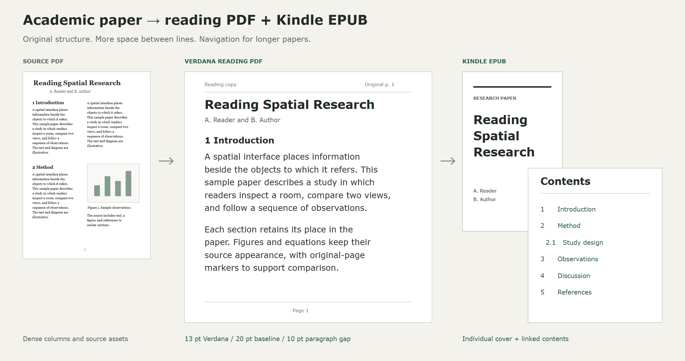

<a id="readme-top"></a>

<div align="center">

# Papers to Markdown

Convert PDFs into spacious **Verdana reading PDFs**, **Kindle EPUBs**, and **Markdown**.<br />Keep figures, equations, references, and a route back to the original pages.

[Quick start](#quick-start) · [Reading guide](docs/reading-guide.md) · [Batch conversion](docs/batch-guide.md) · [Send to Kindle](#send-to-kindle) · [Report an issue](https://github.com/ahnafnafee/papers-to-markdown/issues)

[](https://www.python.org/downloads/) [](LICENSE)

<br />



<sub>Layout illustration with synthetic text. Kindle controls can change the EPUB's appearance.</sub>

</div>

<br />

<details>
<summary><strong>Explore the project</strong></summary>

- [What you can make](#what-you-can-make)
- [Quick start](#quick-start)
- [The reading preset](#the-reading-preset)
- [Convert a collection](#convert-a-collection)
- [Send to Kindle](#send-to-kindle)
- [Markdown and publisher cleanup](#markdown-and-publisher-cleanup)
- [How conversion works](#how-conversion-works)
- [Documentation and development](#documentation-and-development)
- [License and acknowledgments](#license-and-acknowledgments)

</details>

## What you can make

| Output | Built for |
| :--- | :--- |
| **Reading PDF** | A fixed Verdana layout with generous spacing, one column, bookmarks, and original-page markers. |
| **Kindle EPUB** | Reflowable text, an individual portrait cover, visible contents, nested navigation, and embedded document fonts. |
| **Markdown** | Editable notes with figure assets, LaTeX delimiter repair, and publisher boilerplate cleanup. |
| **Reading library** | A searchable local catalogue with PDF and EPUB links, duplicate aliases, and notes for flagged pages. |

Figures, tables, and display equations retain their source appearance. When a character cannot be reproduced reliably, its original rendering is preserved and the conversion report flags the passage for comparison.

## Quick start

Install [uv](https://docs.astral.sh/uv/getting-started/installation/), Python 3.13, and [TeX Live](https://www.tug.org/texlive/) or [MiKTeX](https://miktex.org/) with `xelatex` on your path. Reading mode uses an installed copy of Verdana, including its regular, bold, italic, and bold italic faces. Windows is the validated platform; see [font setup](docs/reading-guide.md#requirements) for other installations.

```powershell
git clone https://github.com/ahnafnafee/papers-to-markdown.git
cd papers-to-markdown

uv run --locked --script read.py "C:\Papers\example.pdf"
```

The first conversion downloads the locked environment and layout models. Extraction runs locally. Each paper gets a folder under `output/pdf/` containing its reading PDF, EPUB, HTML preview, assets, and conversion report.

> [!TIP]
> Use `--format epub` for EPUB output alone, or `--format pdf` for a reading PDF alone. EPUB-only output does not need XeLaTeX; installed Verdana is still required.

## The reading preset

The `verdana-reading` preset gives paragraphs a consistent measure and enough space to follow each line. Both reading outputs come from the same extracted document.

| Setting | Default |
| :--- | :--- |
| Typeface | Verdana |
| PDF body / baseline | 13 pt / 20 pt |
| Paragraph gap | 10 pt, with no first-line indent |
| Page | US Letter, single column, left aligned |
| Margins | 1.05 in left/right; 0.90 in top; 0.85 in bottom |
| EPUB | Corresponding relative spacing, embedded fonts, and linked contents |

Adjust the type and spacing together:

```powershell
uv run --locked --script read.py "C:\Papers\example.pdf" --font-size 14 --line-spacing 22 --paragraph-spacing 11
```

EPUBs include a high-contrast cover using the paper's title and available authors, followed by a visible table of contents. Numeric citations and recovered footnotes link to their targets when the source provides an unambiguous match. On Kindle, select the publisher font when available; device settings can override document fonts and spacing.

[Explore the reading guide →](docs/reading-guide.md)

## Convert a collection

```powershell
uv run --locked --script read.py "C:\Papers" --workers 4
```

**Only PDFs directly inside the folder are selected by default.** Add `--recursive` to include subfolders, and use `--dry-run` to check the selection before conversion. Byte-identical files are converted once.

One inference process shares work with isolated export processes. A bounded queue limits outstanding jobs, and per-paper receipts verify saved files before they are reused. Run the same command again to resume. In parallel mode, a stalled parser is stopped and retried with a different backend while other papers continue.

For an inventoried collection, the library tools also publish `PDFs/`, `EPUBs/`, a searchable `START HERE.html`, and page-specific review notes to a separate destination.

[Batch options, publication, and recovery →](docs/batch-guide.md)

## Send to Kindle

Sign in once in a dedicated local browser profile, then send an EPUB and inspect Amazon's processing status:

```powershell
uv run --locked --script kindle.py login
uv run --locked --script kindle.py send "C:\Reading Copies\example.epub"
uv run --locked --script kindle.py status
```

Windows opens installed Edge by default; `--browser chrome` selects Chrome. Sign-in stays outside the repository. Delivery receipts prevent repeat uploads of accepted files, and uncertain submissions require an explicit resend. Add `--send-to-kindle` to a reading conversion to send EPUBs that have no outstanding review flags.

> [!NOTE]
> The sender follows Amazon US's undocumented web upload flow, which can change. `IN_LIBRARY` confirms Amazon has processed a document; sync the Kindle to download it. Physical-device appearance still needs checking.

[Sending guide and protocol notes →](docs/send-to-kindle.md)

## Markdown and publisher cleanup

The existing Markdown converter remains available through `main.py`:

```powershell
uv sync
uv run main.py --files "C:\Papers\example.pdf"
uv run main.py --root "C:\Papers" --venue ieee
```

Markdown is the default and goes to `output/markdown/`. Venue detection covers ACM, IEEE, arXiv, Springer, Elsevier, NeurIPS, ICML, ICLR, ACL, and CVF. Use `--venue none` to keep publisher boilerplate. The original `pdf-craft` EPUB route remains available with `main.py --format epub`; choose `read.py` for the Verdana reading preset.

[Markdown options and compatibility →](docs/markdown-guide.md)

## How conversion works

```text
Source PDFs → local layout extraction → shared document + source regions
                                          ├─ Verdana PDF
                                          ├─ Kindle EPUB + HTML preview
                                          └─ validation + review report
```

Original prose is reflowed, and original PDFs stay in place. Extraction is cached separately from formatting, so changing the reading profile reuses the layout analysis. Source-page audits, output text checks, link checks, and file hashes help identify gaps; optional EPUBCheck adds formal EPUB validation.

Reading and Markdown conversion use separate environments because their extraction libraries require different dependency versions. Their entry points manage that separation through uv.

## Documentation and development

| Guide | Contents |
| :--- | :--- |
| [Reading copies](docs/reading-guide.md) | Fonts, spacing, OCR, metadata, output files, and review flags. |
| [Batch libraries](docs/batch-guide.md) | Parallel conversion, checkpoints, inventory schema, publication, and recovery. |
| [Kindle delivery](docs/send-to-kindle.md) | Sign-in, sending, duplicate protection, observed protocol, and validation limits. |
| [Markdown conversion](docs/markdown-guide.md) | Existing converter options, publisher rules, and EPUB compatibility. |
| [Development](docs/development.md) | Project structure and local verification. |

Run the local checks:

```powershell
uv run --no-project --with playwright==1.64.0 python -m unittest discover -s tests -v
uv run python test_main.py
```

Contributions should include focused checks for changed behavior and keep source papers, fonts, browser profiles, and generated libraries out of commits. Report conversion problems with the affected page numbers and a shareable source when possible.

## License and acknowledgments

[MIT](LICENSE). Built on [Docling](https://github.com/docling-project/docling) for reading-mode extraction and [pdf-craft](https://github.com/oomol-lab/pdf-craft) for the existing Markdown and EPUB converter, with [XeTeX](https://www.tug.org/xetex/) for reading PDFs and [Playwright](https://playwright.dev/python/) for Kindle browser sessions.

Verdana is supplied by your font installation. Its font files are not distributed in this repository.

<div align="right">

[Back to top ↑](#readme-top)

</div>
